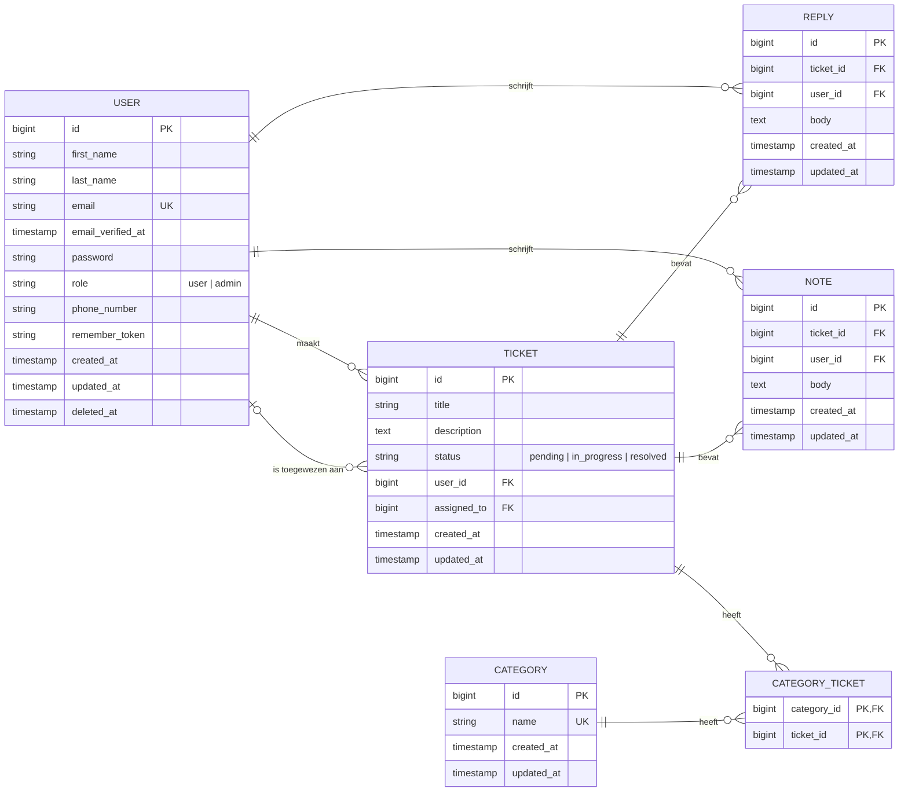

# Database

| Entiteit | Tabel | Doel | Issues |
| --- | --- | --- | --- |
| Gebruiker | `users` | Accounts, rollen en contactgegevens | #5–#11, #16 |
| Ticket | `tickets` | Vragen/problemen met status, maker en toewijzing | #12–#17, #22–#28 |
| Categorie | `categories` | Door administrators beheerde categorieën | #13, #18–#21 |
| Categorie-ticket | `category_ticket` | Koppeltabel voor de N:M-relatie | #13, #19–#21 |
| Reactie | `replies` | Antwoorden op een ticket | #22–#24 |
| Notitie | `notes` | Interne notities voor administrators | #25–#28 |

- `||` = precies één
- `|o` = nul of één
- `o{` = nul of meer
