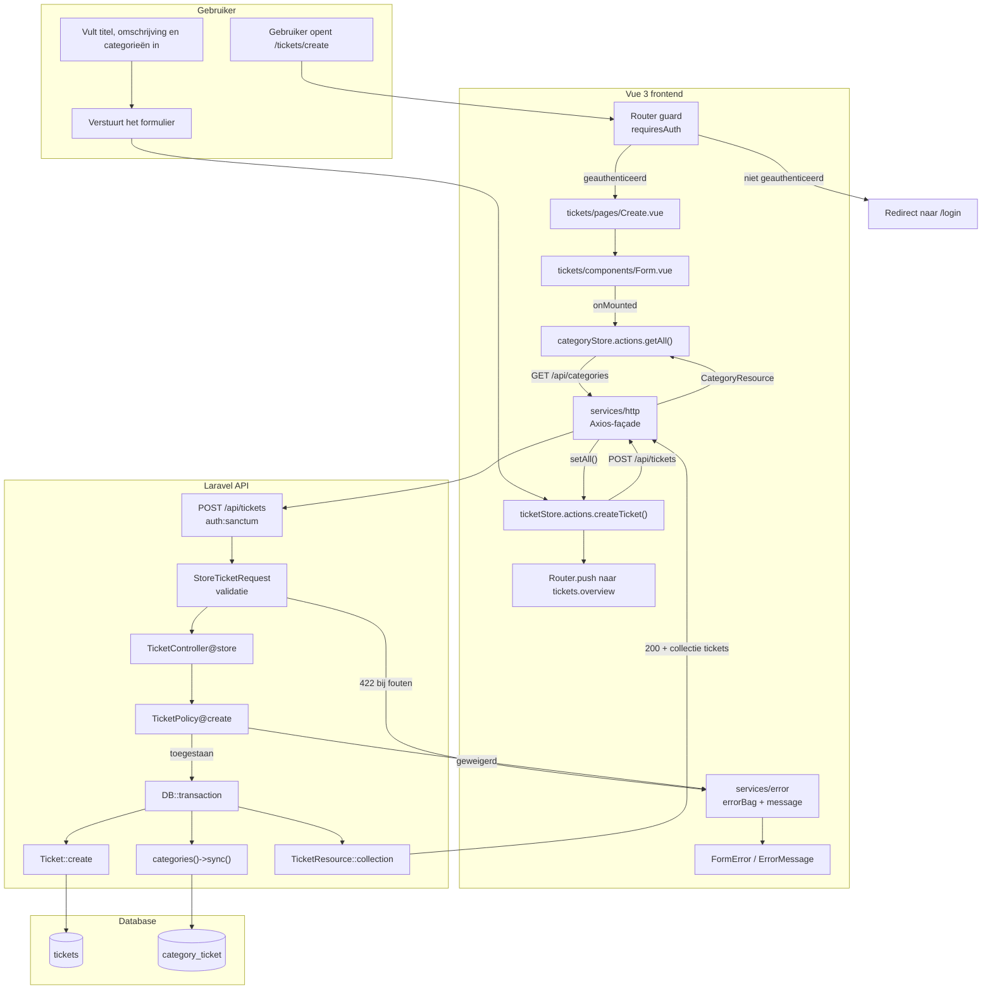

# Flowchart

## Hoofdflow: ticket aanmaken

## Stap voor stap

1. **Router guard** (`resources/js/router/index.ts`)
   De route `/tickets/create` heeft `meta.requiresAuth`. Zonder geldige sessie wordt de gebruiker naar `/login` gestuurd.

2. **Pagina en formulier**
   `tickets/pages/Create.vue` rendert `tickets/components/Form.vue`. Het formulier bevat titel, omschrijving en een meervoudige select voor categorieën.

3. **Categorieën laden**
   `Form.vue` roept bij `onMounted` `categoryStore.actions.getAll()` aan. Dit gaat via `services/http` naar `GET /api/categories`. `CategoryController@index` autoriseert via `CategoryPolicy@viewAny` en retourneert `CategoryResource::collection`. De store vult de select-opties.

4. **Formulier versturen**
   `Create.vue` vangt de submit op en roept `ticketStore.actions.createTicket(data)` aan. De data bestaat uit `title`, `description` en `categories` (lijst met category-id's).

5. **HTTP en validatie**
   `services/http` verstuurt `POST /api/tickets`. De route zit achter `auth:sanctum`. `StoreTicketRequest` valideert de velden en geeft bij fouten een 422-response met `errors` en `message` terug. De Axios-interceptor zet deze in `services/error`; `FormError` toont de veldfouten.

6. **Autorisatie**
   `TicketController@store` roept `$this->authorize('create', Ticket::class)` aan. `TicketPolicy@create` staat dit toe voor elke geauthenticeerde gebruiker.

7. **Transactie**
   Binnen `DB::transaction` wordt eerst de ticket aangemaakt met de ingelogde gebruiker als `user_id` en status `pending`. Daarna worden de gekozen categorieën via de pivot-tabel `category_ticket` gekoppeld. Als één van beide stappen faalt, wordt alles teruggedraaid.

8. **Response**
   De controller retourneert `TicketResource::collection` met alle tickets die de gebruiker mag zien. De frontend-store vervangt haar state met deze collectie en de gebruiker wordt teruggestuurd naar het ticketoverzicht.

## Foutpaden

| Situatie | Afhandeling |
| --- | --- |
| Niet ingelogd | Router guard stuurt naar `/login` |
| Validatiefout (422) | Axios-interceptor vult `errorBag`/`message`; `FormError` toont de fout |
| Geen toegang (403) | Axios-interceptor zet `message`; `ErrorMessage` toont de fout |
| Ticket niet gevonden (404) | Axios-interceptor zet `message`; de pagina toont een melding |

## Componenten en verantwoordelijkheden

### Vue-frontend

| Component | Verantwoordelijkheid |
| --- | --- |
| `tickets/pages/Create.vue` | Pagina, submit afhandelen en navigatie |
| `tickets/components/Form.vue` | Formulierstate en categorieën laden |
| `tickets/store.ts` | API-acties en genormaliseerde ticketstate |
| `categoryStore` | Categorieën laden voor de select |
| `services/http` | Axios-façade, CSRF en foutinterceptors |
| `services/error` | Gedeelde foutenstate |
| `router/index.ts` | Routes en auth/admin guards |

### Laravel-backend

| Component | Verantwoordelijkheid |
| --- | --- |
| `routes/api.php` | API-routes en `auth:sanctum` |
| `StoreTicketRequest` | Validatie van ticketinput |
| `TicketController@store` | Autorisatie, transactie en response |
| `TicketPolicy` | Wie een ticket mag aanmaken, zien en wijzigen |
| `Ticket`-model | Relaties naar gebruiker, categorieën, reacties en notities |
| `TicketResource` | API-representatie van een ticket |
| `category_ticket` | Pivot-tabel voor de N:M-relatie |

## Issue #4

Deze flowchart is gebaseerd op de werkelijke code: `Create.vue` → `Form.vue` → `ticketStore` → `services/http` → `routes/api.php` → `StoreTicketRequest` → `TicketController@store` → `TicketPolicy` → database → `TicketResource`.
